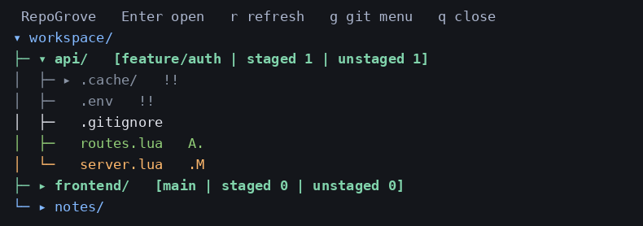

# RepoGrove.nvim

Дерево рабочего каталога с независимым Git-статусом каждой рабочей копии. Нужны Neovim 0.10+ и Git в PATH. Без Lua-зависимостей.



## Установка

С lazy.nvim добавьте спецификацию `{ 'whiterabbit1983/repogrove.nvim', cmd = 'RepoGrove' }`. Без менеджера плагинов на Linux:

```sh
mkdir -p ~/.local/share/nvim/site/pack/local/start
git clone https://github.com/whiterabbit1983/repogrove.nvim.git ~/.local/share/nvim/site/pack/local/start/repogrove.nvim
```

После перезапуска выполните `:RepoGrove /путь/к/папке` или `:RepoGrove` для текущего каталога. Дерево открывается в новой вкладке. Директории читаются при раскрытии, символьные ссылки не обходятся. Обнаруживаются также рабочие копии с файлом `.git` (worktree, submodule).

- **Enter** — раскрыть папку или открыть файл в соседнем окне.
- **g** на репозитории или внутри него — меню `status`, `add -p`, `commit`, `pull`, `push` и `shell`. Все команды выполняются в корне выбранной рабочей копии. `commit` открывает настроенный Git-редактор; для Neovim можно задать `git config --global core.editor nvim`. Ничего не добавляется в индекс автоматически. Через `shell` доступны и другие команды, например `git add -- new-file`, `git restore --staged`, `git switch` и `git rebase -i`.
- **r** — перечитать дерево и Git-статусы. При возвращении в буфер дерева или завершении запущенной команды статусы также обновляются.
- **q** — закрыть дерево. Для выхода из shell наберите `exit`; из режима ввода терминала в normal mode — `Ctrl-\\`, затем `Ctrl-N`.

**Обозначения.** Зелёная папка — корень рабочей копии. `staged` — число записей с подготовленными изменениями; `unstaged` — неподготовленные изменения, конфликты и новые неотслеживаемые файлы. Частично подготовленный файл входит в оба числа. Удалённые файлы учитываются в счётчиках, но не рисуются в дереве файловой системы. Изменения показаны двумя символами Git (индекс / рабочая копия): `A.` — добавлен в индекс, `.M` — изменён на диске, `MM` — изменён и там и там, `??` — новый. `!!` и серый цвет — игнорируется Git и не входит в счётчики. Уже отслеживаемый файл не становится игнорируемым только из-за записи в `.gitignore`.
